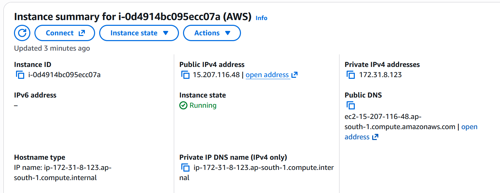
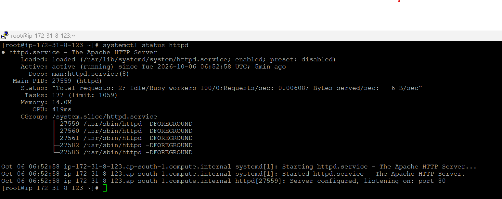
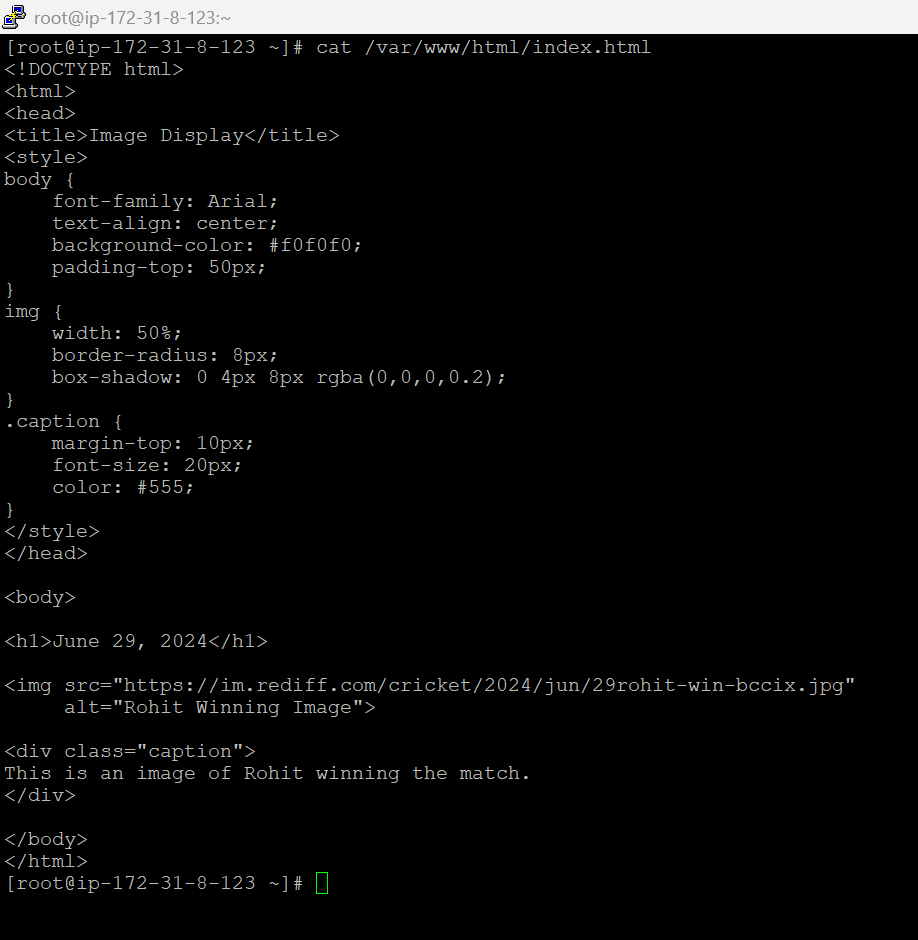

# AWS EC2 Static Website Hosting with Apache (httpd)

Hosted a simple static website on an Amazon EC2 instance using Apache (httpd) on Amazon Linux, and accessed it from the browser using the instance's public IP.

## Architecture

| Component | Details |
|---|---|
| Region | ap-south-1 (Mumbai) |
| Instance type | t3.micro |
| OS | Amazon Linux 2023 |
| Web server | Apache httpd |
| Ports open | 22 (SSH), 80 (HTTP) |
| Web root | `/var/www/html` |

## Steps

### 1. Launch the EC2 instance
Launched a t3.micro EC2 instance with Amazon Linux 2023 and allowed **SSH (22)** and **HTTP (80)** in the security group. The instance reached the **Running** state and was assigned a public IPv4 address.



### 2. Install and start Apache
Connected to the instance over SSH and ran:

```bash
sudo yum install httpd -y
sudo systemctl start httpd
sudo systemctl enable httpd
systemctl status httpd
```

The service shows **active (running)** and is listening on port 80.



### 3. Add the website page
Created an `index.html` in the web root (the full script is in [index.html](index.html)):

```bash
sudo nano /var/www/html/index.html
cat /var/www/html/index.html
```



### 4. Open the public IP in a browser
Opened `http://<public-ip>` in a browser and the page loaded successfully.


## Files

| File | Description |
|---|---|
| `index.html` | The web page served by httpd |
| `*.png` | Screenshots of each step |

## What I Learned

- How to launch and connect to an EC2 instance
- How security group rules control access to SSH and HTTP
- How to install, start and enable Apache httpd as a service
- How httpd serves files from `/var/www/html`
